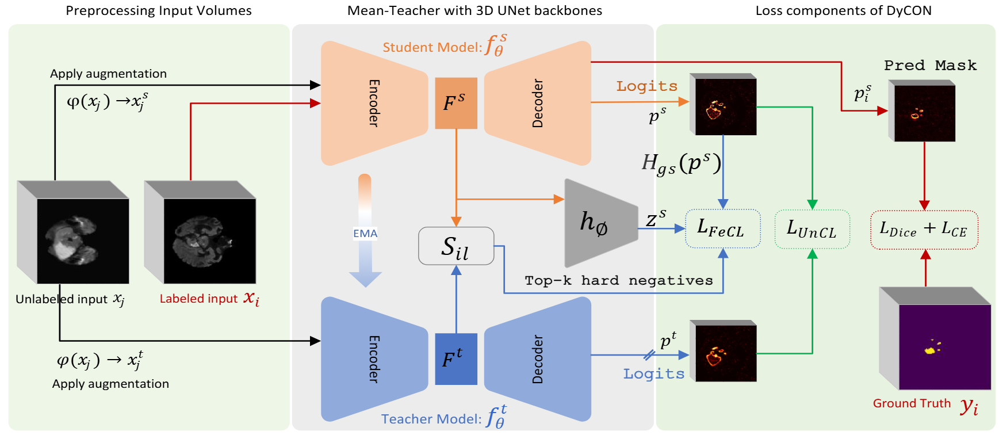

# Mamba vs. 3D U-Net for Semi-Supervised Pancreas Segmentation

Code for my diploma thesis at the School of Electrical and Computer Engineering,
National Technical University of Athens (NTUA, 2026). The full thesis (in Greek) is in
[docs/thesis.pdf](docs/thesis.pdf).

The thesis asks whether a Mamba (State Space Model) backbone, **Swin-UMamba**, beats a plain
**3D U-Net** for pancreas segmentation in CT when only a few scans are labeled. It also measures how much a
parameter-free post-processing step, **Largest Connected Component (LCC)** filtering, adds on top. Both
backbones are trained with **DyCON** (CVPR 2025), a semi-supervised mean-teacher framework. Every
experiment ran on **one free Kaggle GPU (NVIDIA T4, 16 GB)**.

## At a glance

- **LCC post-processing is the largest single improvement.** Keeping only the largest connected component
  halves Swin-UMamba's HD95 (74.00 → 36.41) and cuts the 3D U-Net's ASD from 21.55 to 2.22 voxels. It has no
  learnable parameters. 3D U-Net + DyCON + LCC reaches 71.09% Dice in the 12-label setting (71.89% fully
  supervised).
- **At 64³ patches the CNN wins in every setting.** Each 64×64 slice reaches the deepest Swin-UMamba stage as a
  2×2 grid, and slices are processed independently. So the long-range context that SSMs are built for is mostly
  missing. The 3D U-Net also has about 10× fewer parameters (6.2M vs. 60.4M).
- **Built for a 16 GB GPU.** The setup uses 64³ patches and batches of 2 scans with gradient accumulation.
  Swin-UMamba runs in slice chunks, and training resumes across time-limited sessions
  ([trade-offs](#working-within-one-free-gpu)).
- **Read the numbers with two caveats** found in a code audit after submission. Both come from the upstream
  DyCON code: the 20 evaluation scans are also in the training list, and the contrastive loss reads the
  ground-truth masks of the "unlabeled" scans ([what the numbers mean](#what-the-numbers-mean)).

---

## The problem

Pancreas segmentation is one of the harder organ-segmentation tasks in abdominal CT. The pancreas is small, its
shape varies a lot between patients, and its boundary with the surrounding tissue has low contrast. Voxel-level
labels take expert time, so labeled scans are scarce. Semi-supervised learning addresses this by training on a
few labeled scans plus many unlabeled ones.

State Space Models such as Mamba model long-range dependencies at linear cost, and Mamba-based U-Nets report
strong results in medical segmentation. The thesis tests that claim under realistic constraints:

1. Inside a state-of-the-art semi-supervised framework (DyCON), does a Mamba backbone beat a 3D U-Net?
2. How much does simple, classical post-processing add on top of either network?
3. What can be done on a single free GPU?

**Data.** NIH [Pancreas-CT](https://www.cancerimagingarchive.net/collection/pancreas-ct/) contains 82
contrast-enhanced abdominal CT scans with 512×512 slices and 1.5–2.5 mm slice thickness. The pancreas masks were
drawn manually and checked by a radiologist. I used the preprocessed `.h5` volumes released by the DyCON authors
(cropped and intensity-normalized, about 140×215×130 voxels on median).

## Approach

<p align="center">
  
  <br/>
  <sub>The DyCON framework (figure from the <a href="https://github.com/CVML-KU/DyCON">official DyCON repository</a>).</sub>
</p>

### Training step (DyCON mean teacher)

1. **Batch.** Each batch holds 1 labeled and 1 unlabeled scan. Each scan contributes a random 64³ crop, with half
   of the crops centred on the pancreas, followed by a random 90° rotation and flip.
2. **Student and teacher.** The student network sees the batch. The teacher, an exponential moving average of the
   student with decay 0.99, sees the same batch plus Gaussian noise.
3. **Loss:**
   - **Supervised:** class-weighted cross-entropy (pancreas weighted 9× the background) plus Dice loss, on the
     labeled scan.
   - **UnCL:** an uncertainty-aware consistency loss between student and teacher that down-weights voxels where
     either network has high entropy. β is annealed from 5 to 0.5.
   - **FeCL:** a focal contrastive loss on 256-d feature embeddings of the unlabeled scan. Same-class pairs are
     pulled together and different-class pairs pushed apart, with hard pairs up-weighted. An extra term penalizes
     student–teacher pairs from different classes that are too similar.
   - **Consistency:** an MSE consistency term on the unlabeled scan, ramped up during training.

   The total loss is `supervised + 0.5 · (UnCL + FeCL) + w(t) · consistency`, where `w(t)` ramps up toward
   0.1.
4. **Optimization.** Gradients accumulate over 4 steps, so each update sees 8 scans. The optimizer is AdamW at
   1e-4 with linear warm-up, cosine decay and gradient clipping at 1.0, for 20k iterations.

### The two backbones

| | Swin-UMamba | 3D U-Net |
|---|---|---|
| Type | Mamba / SSM (VSS blocks with a four-direction selective scan), MONAI decoder | Convolutional (DyCON's 3D U-Net) |
| Works in | 2D: the 64³ patch is split into 64 slices, run in chunks of 8, then stacked back into 3D | 3D |
| Contrastive features | Bottleneck features stacked to 3D, resized and projected to 256-d | Bottleneck features projected to 256-d |
| Parameters | 60.4M | 6.2M |
| Encoder initialization | VMamba-tiny ImageNet weights (`--use_pretrain 1`), as described in the thesis | random |

### Post-processing: Largest Connected Component

At test time, a sliding window (64³, stride 32) produces a binary mask. LCC splits the mask into 3D connected
components (26-connectivity) and keeps the largest one, which removes false-positive islands far from the
pancreas. It is the same step for both backbones and has no parameters. Its weak point is that it assumes the
largest component is the pancreas.

### What I built on top of the upstream code

The training framework, the UnCL and FeCL losses, the 3D U-Net and the PancreasCT loader come from
[DyCON](https://github.com/CVML-KU/DyCON). The 2D Swin-UMamba network comes from
[Swin-UMamba](https://github.com/JiarunLiu/Swin-UMamba). My additions:

- **Swin-UMamba inside DyCON.** A wrapper runs the 2D network slice by slice in memory-bounded chunks, stacks the
  outputs back into a volume and adds a 3D projection head for FeCL
  ([`SwinUMamba_DyCON.py`](code/networks/SwinUMamba_DyCON.py)). It also loads the VMamba ImageNet weights.
- **Training that fits one 16 GB GPU.** Gradient accumulation, AdamW with warm-up and cosine decay, full-state
  checkpoints that resume a run in a new session, and pruning to the best checkpoints
  ([`train_DyCON_Pancreas.py`](code/train_DyCON_Pancreas.py)).
- **Class imbalance in small patches.** Foreground-aware random crops ([`pancreas.py`](code/dataloaders/pancreas.py))
  and class-weighted cross-entropy.
- **Fully supervised baselines.** A labeled-only sampling mode, used when the whole batch is labeled.
- **LCC evaluation.** Sliding-window inference that reports Dice, HD95 and ASD before and after LCC, with optional
  NIfTI export and per-case CSV ([`evaluate_pancreas_lcc.py`](code/evaluate_pancreas_lcc.py)).
- **The experiments.** Swin-UMamba vs. 3D U-Net, semi-supervised vs. fully supervised, raw vs. LCC.

---

## Results

PancreasCT, mean ± standard deviation over the 20 evaluation scans, from Chapter 6 of the thesis. HD95 and ASD are
in voxels. "12-label setting" means DyCON with 12 labeled and 50 unlabeled scans; see the caveats below.
The best value in each row is in bold; it is always 3D U-Net + LCC.

**Dice (%) ↑**

| Training | Swin-UMamba, raw | Swin-UMamba + LCC | 3D U-Net, raw | 3D U-Net + LCC |
|---|:---:|:---:|:---:|:---:|
| DyCON, 12-label setting | 46.08 ± 11.97 | 57.60 ± 24.09 | 63.60 ± 14.57 | **71.09 ± 17.63** |
| Fully supervised, 62 labels | 55.56 ± 9.22 | 63.65 ± 11.69 | 66.90 ± 7.87 | **71.89 ± 11.09** |

**HD95 ↓**

| Training | Swin-UMamba, raw | Swin-UMamba + LCC | 3D U-Net, raw | 3D U-Net + LCC |
|---|:---:|:---:|:---:|:---:|
| DyCON, 12-label setting | 74.00 ± 18.72 | 36.41 ± 43.98 | 63.99 ± 14.25 | **20.51 ± 23.82** |
| Fully supervised, 62 labels | 68.20 ± 18.29 | 27.61 ± 18.96 | 54.16 ± 19.11 | **24.60 ± 26.52** |

**ASD ↓**

| Training | Swin-UMamba, raw | Swin-UMamba + LCC | 3D U-Net, raw | 3D U-Net + LCC |
|---|:---:|:---:|:---:|:---:|
| DyCON, 12-label setting | 32.39 ± 10.37 | 12.85 ± 27.09 | 21.55 ± 6.39 | **2.22 ± 1.44** |
| Fully supervised, 62 labels | 25.80 ± 8.43 | 2.83 ± 2.52 | 17.45 ± 6.32 | **1.78 ± 0.77** |

The evaluation script in this repository reproduces the thesis Swin-UMamba numbers exactly from the saved
checkpoint. The checkpoints themselves (about 1 GB each) are not included.

### What the results show

- **LCC fixes most of the boundary error.** Raw predictions contain scattered false positives far from the
  pancreas, and these dominate HD95 and ASD. Removing them improves every metric for both networks:
  - Swin-UMamba (DyCON): Dice +11.52 points and HD95 halved.
  - 3D U-Net (DyCON): ASD 21.55 → 2.22.

  Per-scan results show both sides of LCC. They come from re-running the thesis evaluation on the saved
  Swin-UMamba (DyCON) checkpoint:
  - LCC raises Dice in 17 of the 20 scans.
  - In 2 scans (PANCREAS_0005 and PANCREAS_0015) the largest component is not the pancreas, so LCC keeps the
    wrong region and Dice falls to 0 (from 43.2% and 27.2%).
  - These two scans account for most of the post-LCC spread. Without them, HD95 is 23.26 ± 19.43 instead of
    36.41 ± 43.98, and ASD is 4.27 ± 4.10 instead of 12.85 ± 27.09.
- **The CNN is ahead at this resolution.** The 3D U-Net beats Swin-UMamba in all four settings. Several factors
  stack up:
  - **Small slices:** a 64×64 slice shrinks to a 2×2 grid in the deepest Mamba stage.
  - **No 3D context:** the 2D wrapper never sees neighbouring slices, while the U-Net convolves in 3D.
  - **Capacity vs. data:** Swin-UMamba has 10× the parameters to fit from few labels.
  - **Domain gap:** the encoder was pretrained on 2D natural images.
- **The results describe a low-resolution regime.** The thesis's own conclusion is that the comparison could flip
  with larger patches and more memory.

---

## What the numbers mean

A code audit after the thesis was submitted found two issues that change how the table should be read. Both come
from the upstream DyCON code that this project builds on.

1. **The evaluation scans overlap the training list.**
   - Training reads `train.list` (PANCREAS_0001–0062; the labeled scans are the first 12).
   - The upstream evaluation code, and so the thesis evaluation, uses `test1.list` (PANCREAS_0001–0020). The same
     list was used to pick the best checkpoint during training.
   - So the 20 evaluation scans were training data. In the 12-label runs, 12 of them were the labeled scans and 8
     were unlabeled training scans. In the 62-label runs, all 20 were labeled training scans.
   - The scans never used in training are `test.list` (PANCREAS_0063–0082).
2. **The contrastive loss sees the masks of the "unlabeled" scans.** The training script builds the FeCL mask from
   the labels of the whole batch, so FeCL on the unlabeled scan uses its ground-truth mask, downsampled to the
   8×8×8 feature grid. The supervised loss, UnCL and the consistency term do not use these labels. Even so, the
   12-label setting is not strictly semi-supervised.

**What this means:**

- The absolute numbers describe how well each model fits scans it was trained on, not how it generalizes to new
  patients.
- "12 labels come close to 62 labels" (71.09% vs. 71.89%) is not a clean measure of label efficiency.
- Comparisons on the same predictions still hold: raw vs. LCC, and Swin-UMamba vs. 3D U-Net trained and
  evaluated under the same protocol. They should still be confirmed on held-out scans.

**What changed in the code:**

- [`evaluate_pancreas_lcc.py`](code/evaluate_pancreas_lcc.py) now evaluates `test.list` by default.
- `--test_list test1.list` reproduces the thesis protocol.
- The FeCL label use is unchanged, so the code still matches the thesis runs, and it is documented where it
  happens in [`train_DyCON_Pancreas.py`](code/train_DyCON_Pancreas.py).

A clean rerun would:

- build the FeCL mask of unlabeled scans from teacher pseudo-labels;
- pick checkpoints on held-out labeled scans;
- report results on `test.list`.

---

## Working within one free GPU

Every run used a single NVIDIA T4 (16 GB) in free, time-limited Kaggle sessions. The table shows what that cost.

| Constraint | What I did | Cost |
|---|---|---|
| 16 GB for a student and a teacher, with mixed precision off (it was incompatible with the Mamba kernels in this setup) | 64³ training patches. DyCON's code default is 112×112×96, about 4.6× more voxels | Less context per patch, which hurts the SSM most |
| Swin-UMamba memory (60.4M parameters, 64 slices per patch) | 2D processing in chunks of 8 slices | No context across slices |
| Only 2 scans fit per step | 1 labeled + 1 unlabeled scan per step, gradients accumulated over 4 steps (effective batch 8) | Noisier BatchNorm statistics; slower training |
| Time-limited sessions | Full-state checkpoints every 100 iterations (student, teacher, optimizer, scheduler, iteration, best score) and `--load_path` to resume | One run spans several sessions |
| Limited disk; about 1 GB per Swin-UMamba checkpoint | Keep only the 5 best checkpoints; a background job deleted intermediate checkpoints older than 30 minutes | Fewer checkpoints to analyze afterwards |
| GPU memory fragmentation | `PYTORCH_ALLOC_CONF=expandable_segments:True`; CUDA cache cleared before runs and after skipped steps | None |
| Validation time inside the training budget | Validation every 200 iterations with a coarse window (stride 64; the final evaluation uses stride 32) | Noisier checkpoint selection |
| GPU hours | One seed and one split per configuration. The fully supervised Swin-UMamba baseline ran 10k iterations instead of 20k | No spread across runs; the ± in the tables is across scans |

### With more compute, next steps would be

- **Clean evaluation:** evaluate on held-out scans with a separate labeled validation set and pseudo-label masks
  for FeCL, as described above.
- **More context:** use larger patches (96³–128³) or whole volumes, and a backbone that scans in 3D, so the
  Mamba blocks get the context they are designed for.
- **Mixed precision:** bf16 on newer GPUs, where the kernels support it, to afford larger patches.
- **Statistics:** several seeds and cross-validation folds, so the comparison has error bars across runs.
- **Learned refinement instead of LCC:** a learned local refinement in the network (as proposed in the thesis),
  and a per-class LCC for multi-organ segmentation.

---

## Repository layout

```
code/
├── train_DyCON_Pancreas.py     # training (semi-supervised or fully supervised)
├── evaluate_pancreas_lcc.py    # sliding-window evaluation, raw vs. LCC
├── dataloaders/pancreas.py     # dataset, foreground-aware crop, two-stream sampler
├── networks/                   # Swin-UMamba (+ DyCON wrapper), 3D U-Net, network factory
└── utils/                      # DyCON losses (UnCL, FeCL), Dice/MSE losses, sliding-window inference
scripts/                        # train / evaluate with the thesis settings
data/Pancreas/                  # split lists only (volumes are not included)
docs/                           # thesis PDF, DyCON figure
LICENSES/                       # Apache-2.0 text for the Swin-UMamba code
```

## Setup

The code needs a CUDA GPU. The thesis runs used Python 3.12, PyTorch 2.10, mamba-ssm 2.3.1 and causal-conv1d 1.6.1
on Kaggle.

```bash
conda create -n pancreas-ssl python=3.12 -y
conda activate pancreas-ssl

# PyTorch >= 2.3 built for your CUDA version, see https://pytorch.org/get-started/locally/
pip install torch torchvision

pip install -r requirements.txt
pip install mamba-ssm causal-conv1d --no-build-isolation   # Swin-UMamba only; may compile CUDA kernels
```

VMamba-tiny ImageNet weights for the Swin-UMamba encoder:

```bash
mkdir -p code/data/pretrained/vmamba
wget -O code/data/pretrained/vmamba/vmamba_tiny_e292.pth \
  "https://github.com/MzeroMiko/VMamba/releases/download/%23v0cls/vssmtiny_dp01_ckpt_epoch_292.pth"
```

## Data

Download the preprocessed PancreasCT volumes from the
[DyCON authors' Google Drive](https://drive.google.com/drive/folders/1kQX8z34kF62ZF_1-DqFpIosB4zDThvPz?usp=sharing)
and put the 82 `.h5` files in `data/Pancreas/Pancreas_data/`.

| List | Scans | Used for |
|---|---|---|
| `train.list` | PANCREAS_0001–0062 | training; the first `--labelnum` scans are labeled |
| `test1.list` | PANCREAS_0001–0020 | checkpoint selection and the thesis evaluation (overlaps `train.list`) |
| `test.list` | PANCREAS_0063–0082 | held-out evaluation, the default of `evaluate_pancreas_lcc.py` |

## Usage

Run from inside `code/`:

```bash
cd code

# Training with the thesis settings
bash ../scripts/train_pancreas.sh                                           # Swin-UMamba + DyCON, 12-label setting
MODEL=unet_3D bash ../scripts/train_pancreas.sh                             # 3D U-Net + DyCON
LABELNUM=62 LABELED_BS=2 MAX_ITERS=10000 bash ../scripts/train_pancreas.sh  # fully supervised baseline
LOAD_PATH=../models/<exp>/<run>/latest_model.pth bash ../scripts/train_pancreas.sh   # resume a run

# Evaluation, raw vs. LCC
bash ../scripts/evaluate_pancreas_lcc.sh ../models/<exp>/<run>/swin_umamba_best_model.pth           # held-out scans
TEST_LIST=test1.list bash ../scripts/evaluate_pancreas_lcc.sh <checkpoint.pth>                      # thesis protocol
MODEL=unet_3D bash ../scripts/evaluate_pancreas_lcc.sh <checkpoint.pth> --csv per_case.csv --save_dir predictions/
```

Each run writes to `models/<exp>/<run>/`:

- `log.txt` and TensorBoard logs (`log/`)
- `latest_model.pth`, saved every 100 iterations, for resuming
- `<model>_best_model.pth`, plus the 5 best `iter_*.pth` checkpoints
- a copy of `code/`

Every hyperparameter is a command-line flag; see `python train_DyCON_Pancreas.py --help`.

## Acknowledgements

- **DyCON** by Assefa et al. ([code](https://github.com/CVML-KU/DyCON)): the training framework, the UnCL and FeCL
  losses, the 3D U-Net and the PancreasCT loader. DyCON itself builds on
  [SSL4MIS](https://github.com/HiLab-git/SSL4MIS).
- **Swin-UMamba** by Liu et al. ([paper](https://arxiv.org/abs/2402.03302),
  [code](https://github.com/JiarunLiu/Swin-UMamba)): the 2D Mamba U-Net.
- **VMamba** ([code](https://github.com/MzeroMiko/VMamba)): the VSS blocks and the ImageNet encoder weights.
- **Pancreas-CT** (NIH Clinical Center, via The Cancer Imaging Archive), and the preprocessed volumes released by
  the DyCON authors.

```bibtex
@inproceedings{assefa2025dycon,
  title     = {{DyCON}: Dynamic Uncertainty-aware Consistency and Contrastive Learning
               for Semi-supervised Medical Image Segmentation},
  author    = {Assefa, Maregu and Naseer, Muzammal and Ganapathi, Iyyakutti Iyappan
               and Ali, Syed Sadaf and Seghier, Mohamed L. and Werghi, Naoufel},
  booktitle = {Proceedings of the IEEE/CVF Conference on Computer Vision and Pattern Recognition (CVPR)},
  year      = {2025}
}

@article{liu2024swinumamba,
  title   = {{Swin-UMamba}: Mamba-based {UNet} with {ImageNet}-based pretraining},
  author  = {Liu, Jiarun and Yang, Hao and Zhou, Hong-Yu and Xi, Yan and Yu, Lequan and Yu, Yizhou
             and Liang, Yong and Shi, Guangming and Zhang, Shaoting and Zheng, Hairong and Wang, Shanshan},
  journal = {arXiv preprint arXiv:2402.03302},
  year    = {2024}
}
```

To cite the thesis:

```bibtex
@mastersthesis{liakis2026thesis,
  author = {Liakis, Dimitrios},
  title  = {Ενίσχυση Μοντέλων Κατάστασης Χώρου με Μετα-Επεξεργασία για Γενίκευση Πεδίου στον Ιατρικό Τομέα
            (Enhancing State Space Models with Post-Processing for Domain Generalization in the Medical Domain)},
  school = {National Technical University of Athens},
  type   = {Diploma thesis},
  year   = {2026},
  note   = {In Greek}
}
```

## Author

**Dimitrios Liakis** · [LinkedIn](https://www.linkedin.com/in/dimitris-liakis-303886277/) ·
[dimliakis2001@gmail.com](mailto:dimliakis2001@gmail.com)

## License

[MIT](LICENSE), covering the original DyCON code (© 2025 Computer Vision and Machine Learning Lab) and my
changes. [`code/networks/SwinUMamba.py`](code/networks/SwinUMamba.py) is adapted from Swin-UMamba under the
[Apache License 2.0](LICENSES/Apache-2.0.txt).
